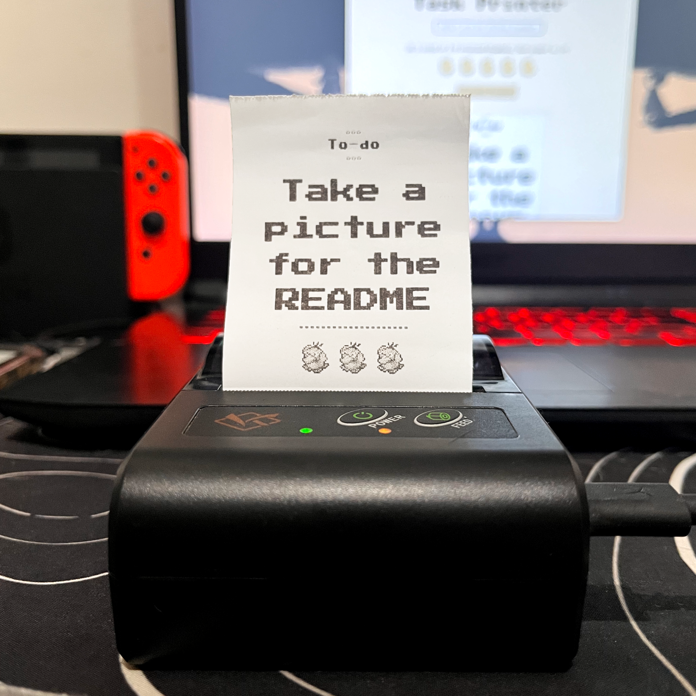
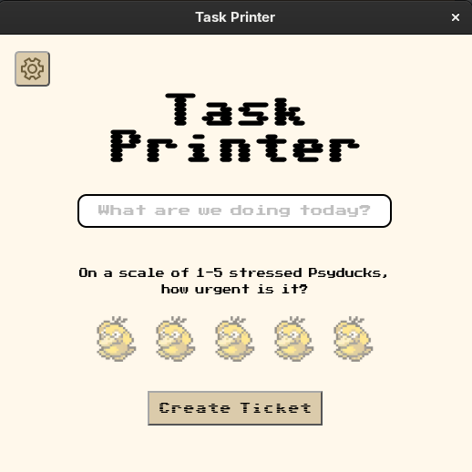
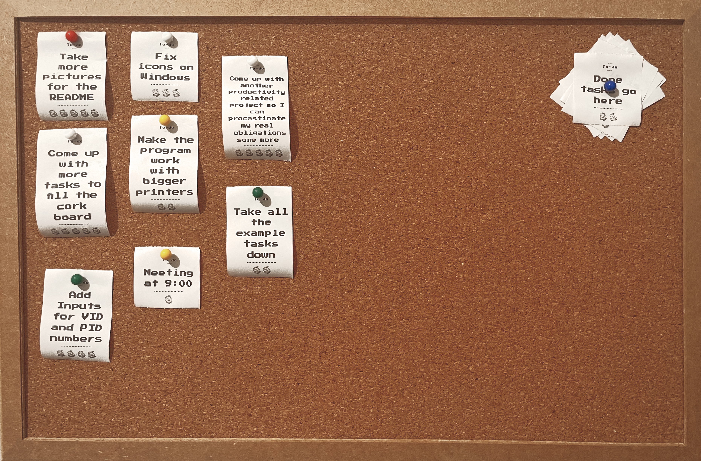
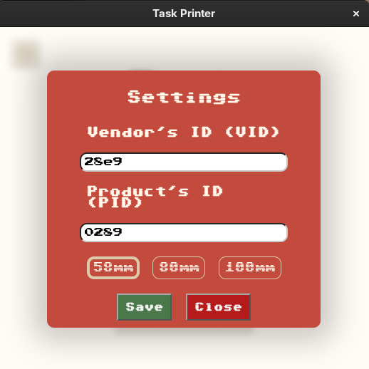
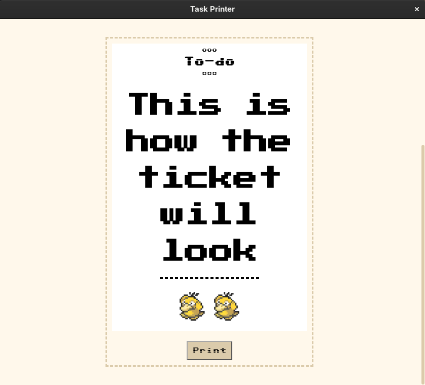

# Task Printer

Some people work best when they can see the tasks they have for the day ahead of them, I am one of those people. This program was made aiming to turn tasks into something physical that can be pinned to a board reminding you of errands you need to run.

<p align="center">
  
  
</p>

Type a task, pick how urgent it is on a "Stressed Psyduck Scale" and get a physical to-do ticket from a USB thermal printer.
Works even better with a cork bulletin board.
<p align="center">
  
</p>

## How it works
<p align="center">
  
  
</p>

1. You setup your printer on a settings windows that accepts a PID, a VID and 3 size options for different printers
2. The app validates and saves the IDs and size to a JSON and automatically displays the current config when you open the settings menu
3. The window builds the ticket preview and captures it as an image with `html2canvas`.
4. The preload script exposes the encoded image and the settings.
5. Through IPC, the main process decodes and saves the image to the computer and uses the user settings to communicate with the printer.
6. The image is converted to black and white using `jimp`, goes through dithering, and is sent to the printer over USB with ESC/POS commands.

## Install

Download the latest installer from the [Releases](../../releases) page.

- **Fedora / RPM:** `sudo dnf install ./task-printer-*.rpm`
- **Windows:** run the `.exe` installer.

## Printer setup

To use this app you first need to find your printer's VID and PID values. 

|                  | Value    |
| ---------------- | -------- |
| Vendor ID (VID)  | `0x28e9` |
| Product ID (PID) | `0x0289` |

On Linux you can find these running `lsusb` which lists all your USB devices with the IDs, on my machine it shows up as:

`Bus 003 Device 008: ID 28e9:0289 GDMicroelectronics YC Printer demo`

On windows you can find these numbers on the `Device Manager`, right-clicking the printer and opening `Properties`


### Linux (udev rule)

By default a regular user can't open raw USB devices, so printing fails. A udev rule gives your user access to this specific printer.

1. Check that the system sees the printer and confirm its IDs (the `ID xxxx:yyyy` part):

```bash
   lsusb
```

2. Create `/etc/udev/rules.d/70-task-printer.rules` with the following content (replace the IDs if yours differ):

```
   SUBSYSTEM=="usb", ATTR{idVendor}=="28e9", ATTR{idProduct}=="0289", MODE="0666"
```

`MODE="0666"` opens the printer to every user on the machine and works more consistently. Alternatively you can replace it with `TAG+="uaccess"` which grants access only to whoever is logged in at the computer.

3. Reload the rules and reconnect the printer:

```bash
   sudo udevadm control --reload-rules && sudo udevadm trigger
```

Then unplug the printer and plug it back in.

### Windows (WinUSB driver with Zadig)

Windows usually binds thermal printers to a standard printing driver, which blocks direct USB access from apps like this one. [Zadig](https://zadig.akeo.ie) replaces that driver with WinUSB for this one device.

1. Download Zadig from the official site and run it.
2. Plug in the printer.
3. In Zadig, open **Options → List All Devices**.
4. Select your printer in the dropdown. If the name isn't obvious, match the **USB ID** shown by Zadig against the VID/PID above (`28E9` / `0289`).
5. Choose **WinUSB** as the target driver and click **Replace Driver** (or **Install Driver**).
6. Unplug and replug the printer.

> [WARNING]
> After this change, Windows will no longer see the device as a regular printer, so other programs can't print to it through the normal Windows print dialog. This can be undone.
>To go back to the normal driver, open Device Manager, uninstall the device and reconnect the printer so Windows installs the default driver again.


## Built with

Electron, Electron Forge, node-escpos, Jimp, html2canvas

